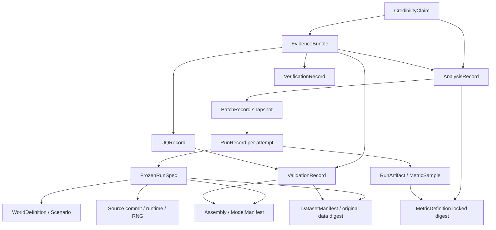

# CONTRACT-04 — Evidence Traceability 与科研声明最低可用契约

> AI-D / B05 | PROPOSED `contract-04@0.1.0` | 2026-10-16。与 [Run/Metric 契约](RUN_AND_METRIC_CONTRACT.md) 成对评审。文档级设计，不是已执行的测试/现实验证。
>
> 上游版本完整 HEAD：#54 `99bd0eb6b910d691d6d7776da0a5fd3f973f2997`；#49 `d155621aca66e3a80c388718093a452d17d71e10`；#47 `68382c649393057ffbf5a14508ab1ff72d575b09`；#52 `a966567b1a2a033f477c2847073cc11777a3afd2`；#53 `9e9d8918c1e6989568e84c3f0d020fdffb0373de`；#50 `c4c0c67111ead435062650c1ed776547c477e3e3`；#51 `f2df96bc609ee1e430ea6eff2456c4577347c300`。共同 base `master@2ab60c69a806a22d7ba20353dee0571752a0e8e5`。均 Draft/unmerged。

## 1. 单向不可变 provenance DAG 和跨职责规则



不可变有向边仅指向已冻结对象 `{type, id, version/revision, sha256}`；`latest`、浮动 PR/branch、无 hash 的 URL 都不能充当证据身份。对 DAG 计算引用完整性：引用可解、被引对象内容 hash 匹配、schema 可读、同一个 id/revision 无互异内容、无环、依赖适用域/角色一致。链接断裂仍保存 Claim/Bundle 并标记 `INCOMPLETE`，不自行“补全”外部数据。

所有权：Harness 独占 **单 Run Record/Artifact**；ARCH-03 定义 MetricDefinition 与组件/数据/模型 provenance；EXP-01 创建 Plan/Batch/Analysis 和 comparison gate；VVE-01 创建 Verification/Validation/UQ、EvidenceBundle 与 CredibilityClaim 并可审阅其他资源但不得覆写；ARCH-04 旧结果只读，以独立 sidecar 引用。所有 actor 都只能追加自己对象的新 immutable revision，VVE 不能伪造执行、Experiment 不能给物理模型发 Validation PASS。

## 2. VVE 对象强制字段与证据状态

| 类型 | 最低必需信息 | 状态与拒绝条件 |
|---|---|---|
| `VerificationRecord` | `record_id, version, target_code/model_contract_digest, test_case_id, expected_invariant, actual_result, test_log_artifact_digest, execution_profile, run_time, reviewer, scope` | `NOT_ASSESSED/PASS/FAIL/INCONCLUSIVE`；未执行的设计 fixture、CI pipeline 总绿不能单独证明特定不变量 PASS |
| `ValidationRecord` | `record_id, version, model_manifest_digest, intended_use, domain_envelope, reference_dataset_digest, source_independence, calibration_set_digest, validation_set_digest, leak_checks, error_metric_definition, observed_error, predeclared_acceptance_threshold, reviewer, limitations, provenance_refs` | `NOT_ASSESSED/PASS/FAIL/INSUFFICIENT/OUT_OF_SCOPE`；无独立现实对照、只用训练/校准数据、无阈值或域不匹配，**绝不 PASS** |
| `UQRecord` | `record_id, version, target_claim/model_ref, uncertain_factors, aleatory_vs_epistemic, ranges/distributions + rationale, sampling_seed_plan, method, sample_count, output_spread/intervals, sensitivity, limitations, artifact_digests` | `NOT_ASSESSED/COMPLETE/INCOMPLETE/FAILED`；结果存在但未标不确定性来源不等于 COMPLETE |
| `EvidenceBundle` | `bundle_id, schema_version, digest, immutable_nodes/edges, included_claim_refs, integrity_report, missing_refs, verification/validation/uq refs, prepared_at, reviewer_ref, export_manifest_digest` | `COMPLETE/INCOMPLETE/REJECTED` 仅表示**证据链接完整性**；COMPLETE 不等于有效模型/结论 PASS |
| `CredibilityClaim` | `claim_id, claim_revision, text, research_question, estimand, intended_use, scope, model/domain_refs, analysis_ref, evidence_bundle_digest, verification/validation/uq_status_refs, caveats, reviewer, decision, decision_time` | `DRAFT/UNDER_REVIEW/SUPPORTED_LIMITED/INSUFFICIENT/REJECTED/SUPERSEDED`；受支持仅在明确范围内成立 |

任何记录的 `status` 必须有被评价目标、方法/准则、证据内容摘要、审查者和决定时间；证据缺口用 `missing_reason` 及 `EvidenceGapReport` 说明，绝不使用空列表推断 PASS。后来新证据形成新 record revision/claim revision，通过 `supersedes` 链接原件，不更改旧内容。

### 一组互不替代的门

- `CI_CHECK`：构建/静态检查/单测流水线状态；只能说相应软件检查成功。
- `VERIFICATION` (V1)：指定模型/代码实现的约束、重放、边界不变量是否符合规格；可引用 CI 具体测试及日志，但不自动全部通过。
- `EXPERIMENT_INTEGRITY`：对照、样本、消融、比较资格；`AnalysisRecord.comparison_gate=PASS` 只证明可比较性及按预注册分析处理，不证明外部世界真实性。
- `VALIDATION` (V2)：独立真实参照、用途/域、观测误差与预先门槛是否达标。没有独立数据/误差：`NOT_ASSESSED`。
- `UQ` (V3)：认知/随机不确定性、敏感性与统计稳健性。没有工作不能默认为“零不确定性”。

**硬约束：** `CI_CHECK=PASS` `!=` `VERIFICATION=PASS` `!=` `VALIDATION=PASS` `!=` `UQ=COMPLETE`，也不意味着 `CredibilityClaim=SUPPORTED_LIMITED`。模型来源真实、原始 flight log 可溯源、同 seed 可重复、Legacy/K1 parity 也不等价现实模型已被验证。

## 3. 最低追溯链与发布门

给定 Claim，验证器必须从 `claim.analysis_ref -> AnalysisRecord(方法/纳排/gate/估计量) -> BatchRecord(snapshot) -> every scheduled logical run + every attempt -> RunRecord -> FrozenRunSpec`，然后展开 `spec -> world/scenario/clock/RNG/assembly/component code/model manifest/dataset manifest`、`run -> actual event log/snapshots/metrics/error`，并对每个 sha256 做内容一致性校验。还应从 Claim -> Bundle -> VVERecords -> 第三方参考/分组/误差/UQ。缺边则报告哪条边断了，不用同名文件猜。

- 证据完整性 `bundle.integrity_status=COMPLETE` 仅能在所有**声明为必须**的证据存在且 digest 有效时给出；optional 限制仍须标记。
- 算法排名：必须存在 `AnalysisRecord.gate=PASS`，估计目标、重复、attempts 与指标一致；`NOT_COMPARABLE` 的分析只能呈现“拒绝原因+独立读数”，绝不创建 `winner/rank`。
- 科研表述分级：模拟环境中某条件下的差异，可以由严谨实验支持，但需注明 `SIMULATION_ONLY`；任何“现实可部署 / 真实节能量 / 真实风险”必须有相同 intended_use/domain 的 Validation PASS 和适用的 UQ 记录，否则 `REAL_WORLD_CLAIM_NOT_SUPPORTED`。
- 所有决定有审查 `scope` 和 `limitations`。领域外推（风速、载荷、空间、地图、机型、任务分布、时段、调度服务规则变化）触发 `OUT_OF_SCOPE`，不得延用原通过状态。
- 敏感数据以可复算的受控访问指纹/脱敏证据保存；digest 不能替代权限、许可证或第三方获取资格；无法重新访问则明确 `SOURCE_UNAVAILABLE`。

## 4. 端到端示例（**合成测试 fixture，非实际结果**）

研究问题：在固定低空物流模拟场景 S 中，Greedy 与 PSO 的超时率是否不同？预注册：相同 world/scenario、同任务生成规则、相同 3600 s horizon、指标 `timeout_rate@1.0.0`，每组两次运行，固定随机扰动计划。实际是否共享外生任务流由 AI-C B04 单独会签。示例数值仅用于检查**引用与状态语义**，不构成“PSO 优于 Greedy”的结论。

```text
CredibilityClaim C-01 [DRAFT, SIMULATION_ONLY, validation=NOT_ASSESSED]
 ├─ EvidenceBundle EB-01 [INCOMPLETE: independent physical validation absent]
 └─ AnalysisRecord AN-01 [gate=PASS only if all comparator tests actually pass]
     ├─ ExperimentPlan EP-01@digest-P [preregistered factors / paired stream policy]
     ├─ BatchRecord BA-01@snapshot-D
     │   ├─ RunRecord R-G-1 [SUCCEEDED, attempt=1, metric=0.10]
     │   │   ├─ FrozenRunSpec SR-G-1@sha256 [world W@digest, scenario S@digest]
     │   │   │   ├─ Assembly: Greedy model/algorithm manifest@digest
     │   │   │   ├─ Data: tasks/map/weather snapshot@digest
     │   │   │   └─ Code: full SHA + environment/seed/clock manifest@digest
     │   │   └─ Artifacts: event_log@digest, metrics@digest, snapshot@digest
     │   ├─ RunRecord R-G-2 [SUCCEEDED, attempt=1, metric=0.08]
     │   ├─ RunRecord R-P-1 [SUCCEEDED, attempt=1, metric=0.07]
     │   └─ RunRecord R-P-2 [SUCCEEDED, attempt=1, metric=0.09]
     └─ MetricDefinition timeout_rate@1.0.0 [digest, numerator/denominator/window]
VVE:
 ├─ VerificationRecord VR-01 [NOT_ASSESSED unless real test log supplied]
 ├─ ValidationRecord VAL-01 [NOT_ASSESSED: no independent flight benchmark]
 └─ UQRecord UQ-01 [NOT_ASSESSED: structural/model uncertainty not quantified]
```

以上 `@digest` 均是说明性占位符，**不可作为真实已验证资源引用**。即使某次 CI 通过，Claim 也只能在完成 gate 和相应统计检验后、在指定模拟域内被人工审阅；真实飞行性能不得标为已确认。两次重复不表示样本功效足够，也不得因图上均值小就自动宣布获胜。

## 5. 审计保全：失败、取消、旧结果、不可比较

- `FAILED/CANCELLED` Run 仍有 RunRecord、last good snapshot、诊断与产物缺口。Experiment 保留所有 dispatch/attempt 历史，不得仅导出 successful runs；`AnalysisRecord` 纳排清单应可重算。
- 缺少模型 manifest、world/dataset hash、run log、metric denominator 或 source code SHA：`evidence=INCOMPLETE`；比较门 `NOT_COMPARABLE` 或根据预注册限定仅描述，永不自动填值。
- `INVALIDATED` 是独立审查结论而非删除动作。保留原 RunRecord 结果及 invalidation decision/ref/reason。
- `results/compare/*`、`results/experiments/*` 历史只读；新索引以 sidecar 指向原路径、文件原始 sha256、读取时间、旧 schema/缺项和 legacy 模式。已有 `results/compare_gate.py` 的拒绝是最低保守约束；旧证据无实验完整 seed/episode 不能被 sidecar “升级”为完整证明。
- `LEGACY_OPAQUE_STEP` 发生非事务错误：标 `TAINTED`、禁止信任后续 Run 状态及所派生的排名；保存首次分歧和故障点。

## 6. 本地 MVP 与退出条件

最低可用可用 JSON manifest + JSONL 状态事件 + 内容摘要文件夹/原始文件引用实现 append-only DAG；导出 portable manifest + 引用完整性报告和明确的缺口列表。无数据库、云服务、区块链、自动模型认证需求。

进入 ARCH-06 前需：四方认可资源 ownership/version/状态；真值哈希/悬挂引用的自动负例；`CI PASS != Validation PASS` 的负例；至少一次真实可执行链验证（本轮只有设计，未执行）；主控签字。ARCH-05-R2 `HOLD/NO-FREEZE` 仍有效。

## 7. 未决与会签

ARCH-02 同意 RunRecord/RunArtifact 唯一作者并落实事件格式；ARCH-03 同意 MetricDefinition digest/registry；EXP-01 同意一次 attempt 一份 RunRecord、预注册 gate 和 Batch snapshot；VVE-01 同意 claim 适用域/独立审查状态；ARCH-04 同意 sidecar 引用不覆写 Legacy；AI-C B04 签共享外生流，AI-A/B 对齐 B01/B02/B03/B06。本 PR 不伪称联合批准。
