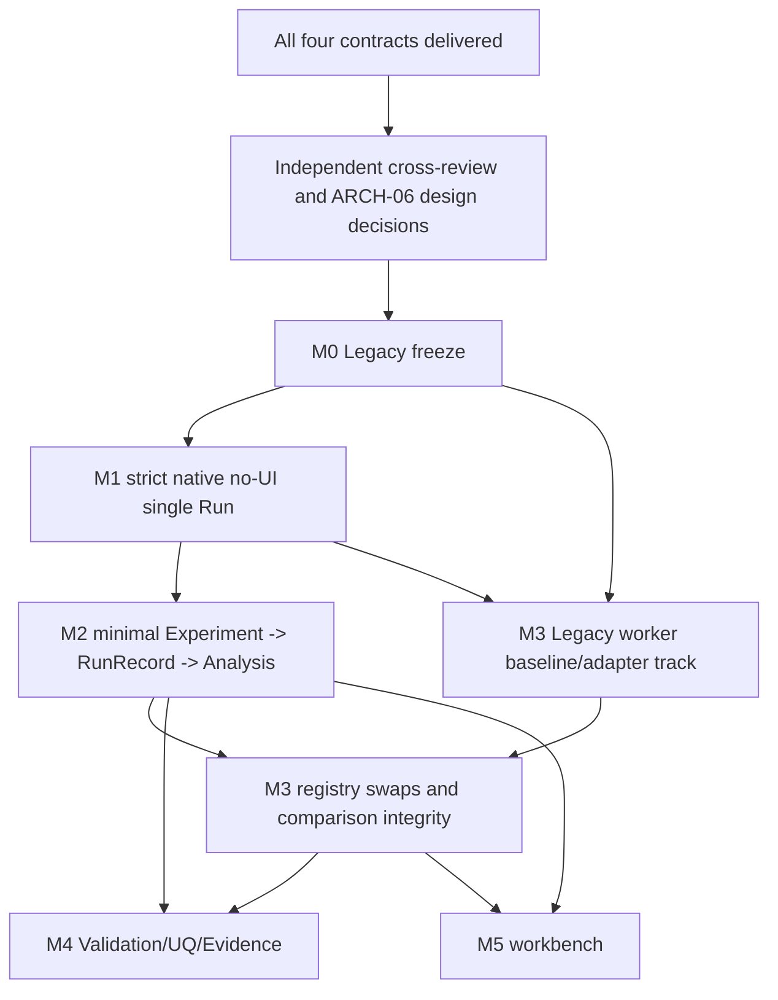

# CONTRACT-05 — Implementation Dependency Plan / ARCH-05-R2 B07

> **PROPOSED / DESIGN-ONLY / NOT ARCH-06 APPROVED**. AI-E cross-architecture route integration. No code/CI/experimental execution in this PR; no upstream PR edits or merges. M0–M5 are **independent acceptance milestones**, not assertions of readiness or a compulsory monolith. On any changed upstream HEAD, invalidate affected matrix cells and re-review.

## 0. Exact input lock (read as submitted Draft designs)

| Input | PR | Full HEAD SHA | Impact |
|---|---|---|---|
| ARCH-05-R2 review | #54 | `99bd0eb6b910d691d6d7776da0a5fd3f973f2997` | B01–B07, 25 interfaces, S01–S07 |
| ARCH-04 Migration | #50 | `c4c0c67111ead435062650c1ed776547c477e3e3` | K0–K4, G-M0…G-M7, S0–S6 |
| EXP-01 | #52 | `a966567b1a2a033f477c2847073cc11777a3afd2` | ExperimentDefinition/Plan/Batch/Analysis |
| VVE-01 | #53 | `9e9d8918c1e6989568e84c3f0d020fdffb0373de` | Verification, Validation, UQ, Claim |
| CONTRACT-01 | #58 | `fa894cde5b22a78f5dcac4b2fbe17b3f17fa3377` | B01/B03: state/time/event |
| CONTRACT-02 | #55 | `b00cd337de2797b9819089b234a113e36513e003` | B02/B06: component interface/private D |
| CONTRACT-03 | #56 | `0b038f29e7f1957bf93e4afd1e3a171d54e5b620` | B04: seed/streams/attempts |
| CONTRACT-04 | #57 | `1f3798ad0b4e378d6ec0d13cc6945b3a1133d118` | B05: Run/Metric/Evidence |
| ARCH-01 World | #46 | `b5f05a70a3306f1799fcae2c3f342f3ed9ee0048` | World/schema/Scenario |
| ARCH-02 Harness | #49 | `d155621aca66e3a80c388718093a452d17d71e10` | single Run runtime |
| ARCH-03 Components | #47 | `68382c649393057ffbf5a14508ab1ff72d575b09` | components, manifests |
| Governance (proposed) | #51 | `f2df96bc609ee1e430ea6eff2456c4577347c300` | ADR-002/003/006 still need acceptance |

All listed design PRs use `master@2ab60c69a806a22d7ba20353dee0571752a0e8e5` as design baseline; legacy lifecycle PR #41 at `f1bf21cc42f2566b2981a1a6092cbedf215db809` is a **different unmerged research engine baseline**, never silently intermixed. Source-specific references: [#58 STATE_COMMIT_CONTRACT](https://github.com/159357yangjun/SwarmBalance/blob/fa894cde5b22a78f5dcac4b2fbe17b3f17fa3377/docs/platform/architecture/contracts/contract-01/STATE_COMMIT_CONTRACT.md), [#58 TIME_AND_EVENT_CONTRACT](https://github.com/159357yangjun/SwarmBalance/blob/fa894cde5b22a78f5dcac4b2fbe17b3f17fa3377/docs/platform/architecture/contracts/contract-01/TIME_AND_EVENT_CONTRACT.md), [#55 COMPONENT_RUNTIME_CONTRACT](https://github.com/159357yangjun/SwarmBalance/blob/b00cd337de2797b9819089b234a113e36513e003/docs/platform/architecture/contracts/contract-02/COMPONENT_RUNTIME_CONTRACT.md), [#56 EXPERIMENT_SEED_CONTRACT](https://github.com/159357yangjun/SwarmBalance/blob/0b038f29e7f1957bf93e4afd1e3a171d54e5b620/docs/platform/architecture/contracts/contract-03/EXPERIMENT_SEED_CONTRACT.md), [#57 RUN_AND_METRIC_CONTRACT](https://github.com/159357yangjun/SwarmBalance/blob/1f3798ad0b4e378d6ec0d13cc6945b3a1133d118/docs/platform/architecture/contracts/contract-04/RUN_AND_METRIC_CONTRACT.md).

## 1. Three separate claims, three separate evidence registers

- **SW: software Verification** — do implemented lifecycle, state ownership, event order, component signatures, rollback, data validation and metrics obey *their frozen specifications*? Requires actual contract tests/CI, input and expected/observed output, code SHA, logs. SW PASS does **not** confer model realism or unbiased experiment.
- **EX: experiment integrity/validity** — is a preregistered comparison supported by controlled factors, exogenous exposure identity, independent replication, complete failure/attempt accounting, MetricDefinition/window/denominator, sound statistical methods and explicit refusal? An analysis gate PASS establishes eligibility, not better real-world performance.
- **RV: reality Validation and UQ** — is the intended-use model supported by **independent** observations, calibration/validation split, error against predeclared thresholds, limited domain and documented epistemic/aleatory uncertainty? External source provenance alone, successful SW, legacy parity, same-seed replay, or simulation-only EX do not satisfy RV.

Keep `software_verification_status`, `experiment_integrity_status`, `reality_validation_status`, `uq_status` and `claim_scope` as separate evidence fields; default `NOT_ASSESSED` until concrete proof. No synthetic confidence score.

## 2. Hard design prerequisites before integrated implementation

| Gate / discrepancy | Exact upstream contract linkage | Owner / signatures | Decision required before |
|---|---|---|---|
| D01 / B01: strict V1 one externally published boundary revision, private ProvisionalView, full B/C/D/queue/RNG rollback | #58 STATE_COMMIT §§2–7; #55 COMPONENT_RUNTIME §§1–4; #46 WORLD_STATE §3 currently permits phase micro-commits | ARCH-02 owner; ARCH-01/03 and AI-A/B co-sign, coordinator ADR-002 | strict M1 execution |
| D02 / B02: only `Scheduler.propose(ObservationV1,ctx)`, `DynamicsModel.propose(StateSliceView,conditions,ModelIntervalRef,ctx)`; stage-specific view_token and domain reducer schema | #55 COMPONENT_RUNTIME §§1–2 + PROPOSAL_AND_OBSERVATION_SCHEMA §§1–4; #58 ChangeSet; #49 RUNTIME_SEQUENCE uses decide/advance as phase names | ARCH-03 owner; ARCH-02/01 and AI-B/A co-sign | M1 |
| D03 / B03: EventSpec/Intent→Envelope, exact uint64 time_ns conversion, phase/priority/producer seq, seal and end-boundary completion fact | #58 TIME_AND_EVENT §§2–6; #55 schema defers those fields to AI-A | ARCH-02 owner; ARCH-01/03/AI-A and EVENT provider sign; coordinator decides horizon/t=0/late input policy | M1 |
| D04 / B06: PURE or tested TRANSACTIONAL D, prepare/abort/no-throw publish, strict checkpoint gate, legacy explicitly opaque | #55 COMPONENT_RUNTIME §4 + failures C06-01…19; #58 STATE_COMMIT §6 | ARCH-02/03, AI-B/A, ARCH-04 | M1, M3 |
| D05 / B04: ExperimentPlan allocation wins over Scenario.default; external CRN exposure keys exclude treatment RunSpec, private keys include run spec; frozen KDF and vectors | #56 EXPERIMENT_SEED §§1–8, REPRODUCIBILITY_TEST_CASES; #58 clock/event; #55 scoped RNG | EXP-01/AI-C owner; ARCH-01/02/03 sign | research-comparable M2 |
| D06 / B05: one Harness RunRecord per attempt even manual; MetricDefinition registry; Experiment Batch/Analysis; VVE Bundle/Claim; immutable digest DAG | #57 RUN_AND_METRIC §§1–5 + EVIDENCE_TRACEABILITY §§1–3 | ARCH-02/03, EXP-01, VVE-01, AI-D | M1 minimal record; M2 comparator; M4 claims |
| D07 / B07: stage dependencies and promotion/rollback independent, no UI gate coupled to model truth | this document + VERTICAL_SLICE_ACCEPTANCE + LEGACY_MIGRATION_GATES; #50 S0–S6, #52 MVP, #53 V0–V3 | AI-E + ARCH-04/EXP/VVE; independent AI-R; coordinator | ARCH-06 stage authorization |

**Identified cross-contract decision to reconcile (not silently resolved here):** CONTRACT-03 calls logical cell identity `(plan_digest,treatment_id,replicate_key,frozen_run_spec_digest)` (#56 RNG_STREAM_OWNERSHIP §4 and EXPERIMENT_SEED §6); CONTRACT-04 presents `logical_run_key=(plan_digest,treatment_id,replication_id)` (#57 RUN_AND_METRIC §3) while requiring spec digest in Batch linkage. Agree exact canonical key, how `replication_id=replicate_key` maps, whether a spec edit creates a *new* cell rather than retry, and which immutable fields determine idempotent selection. **HOLD M2 until EXP-01/AI-C/AI-D sign one canonical rule and execute duplicate/crash fixtures.** Also freeze `ChangeSet` vs `ActionProposalV1/StateDeltaProposalV1` reducer mapping, `view_token` and `BoundaryRef` equivalence, `CommittedFrame` → postcommit MetricSample, error enum aliases and artifact durability. Design intentions align in direction; these are not approved identical wire schemas.

## 3. Ordered stages and independent exit criteria

| Stage | Must have before entry | Smallest deliverable (new isolated files / PR) | Exit evidence / no premature claim |
|---|---|---|---|
| **M0** immutable Legacy baseline | pin source + historical manifests | manifest of master/#41 separate strata, exact input/OSM/config/deps/results sha256, fixed seeds and golden outputs, old entry smoke and compare-gate negative | LEGACY_MIGRATION_GATES L0…L2 with actual before/after hashes; **no change to old metrics** |
| **M1** one native strict Run | M0, signed D01–D04 & D06 record minimum | no-UI World+Scenario import, WorldState, Harness single boundary, one simple `propose` scheduler/dynamics, CommittedFrame and RunRecord + diagnostics; bounded clock/event | fixtures ST-01/03/06/16, C02-01/05/10, C06-01/04, manual RCT-01/03/05 actually run; strict world/queue/RNG/D checkpoint or reject, no UI |
| **M2** smallest *experiment research software* loop | M1, D05 + remaining D06 signed, exact stream/test vectors | ExperimentDefinition/Plan, two frozen scheduler strategies, ≥2 distinct replication keys under preregistered policy, independent Runs+Batch/Analysis, MetricDefinition, explicit comparator refusal; immutable local sidecars | C03-T01/T03/T04 and RCT-02/06/07/09/11/22 actual positive/negative logs; **simulation-only**, statistical sufficiency not claimed by small fixture |
| **M3** real interchangeable components & Legacy K1 | M0, M1 and relevant M2 metric/seed gate when comparing treatments; D02/D04 plus ARCH-04 signatures | replace one Spatial, Scheduler and Dynamics component in separate runs without editing Harness; demonstrate isolated legacy_direct vs legacy_harness one step, map provenance; reversible opt-in route | manifest incompatibility reject; K1/G-M1…M7 applicable, first divergent step; no same-model parity claim until all protected invariants proved |
| **M4** intended-use credibility and robust research evidence | M2 + appropriate M3 source/model lineage and approved comparator | independent reference validation, model operating envelope, split/leak checks, UQ input/parameter/sampling, full EvidenceBundle/Claim DAG with scope | actual ValidationRecord observed errors vs predeclared thresholds; UQRecord, OUT_OF_SCOPE negative cases, RCT-13…16/21; allow NOT_ASSESSED not fabricated PASS |
| **M5** end-to-end professional workbench | M1/M2/M3 user workflow API stable; TaskUI G0/G1 separate | Project/World/Scenario/Run/Experiment create→run→inspect/compare/evidence/export UI with permission/errors/accessibility | user task E2E and API/rollback tests, no UI mutation of truth, failure/export auditable; UI completion neither requires nor implies all models VALIDATED |

M1 native stub fixtures are NOT claimed to reproduce Legacy output. M2 can use **two explicit registered contract-conforming schedulers** under the same small world without proving hot-swap architecture; M3 proves registry-driven real replacement. Meaningful scientific efficacy claims require separate EX/RV gates beyond the minimal M2 software proof. M4 is independently conditional on data; failure to obtain independent data is `NOT_ASSESSED`, not a reason to falsify completed SW milestones.

## 4. Dependency DAG, slice sequence and deferrable features

**Critical path for minimal research vertical slice:** interface arbitration → M0 golden/protection → M1 WorldState/one Harness/one Run/RunRecord → M2 experiment plan/seed exposure/two schedulers/metric definition/attempt-preserving BatchRecord/AnalysisRecord comparator refusal → claim marked `SIMULATION_ONLY; VALIDATION=NOT_ASSESSED`. This is the **first useful research-software closure**, not a real-world model validation or finished UI.

**Must do for M0–M2:** SHA-pinned frozen configuration/source/metric identity; no write to prior results; single writer, atomic/no-publish failure, deterministic event ordering; stable component propose signatures; scoped RNG + explicit seed precedence; one immutable RunRecord per attempt; metric numerator/denominator/missing; strict NOT_COMPARABLE on unknown; full failure/attempt provenance; executable positive/negative gates and a successful rollback/refusal rehearsal.

**May defer after M2 with explicit status:** true hot swap/other spatial engines/multi-world (M3), independent physical validation and UQ if only software readiness is claimed (M4), full GUI & roles (M5), multi-tenant cloud jobs, distributed microservices, plugin marketplace, portable legacy checkpoint, real-flight certification, generalized 3D physics engine. Deferring cannot erase a future claim's required evidence: no research REAL_WORLD claim until M4 passes for that exact intended use.

## 5. PR/CI delivery discipline and release boundary

Each stage uses an independent PR with strict file whitelist, exact base/HEAD, tested positive+negative case IDs, commands, observed logs/artifact SHA, explicit FAIL/UNVERIFIED, expected-vs-actual comparison, regression and rollback exercise. Promote only that stage after signoff; a later stage fail does not silently alter earlier published artifact/research statement. No upstream Draft PR merged by this plan; each contract is currently only a proposed design. CONTRACT-05 docs cannot themselves close B01–B06 or authorize ARCH-06 freeze.

Owners: ARCH-02 controls single Run writer, state and clock; ARCH-01 owns domain schema/validators; ARCH-03 owns proposal interfaces/components/metrics registry; EXP-01 owns experiment planning and analyses; AI-C handles stream schema; VVE owns validation, UQ and claims; ARCH-04 owns Legacy parity and rollback; AI-R reviews independently; coordinator alone approves gate/ADR and implementation sequencing.
