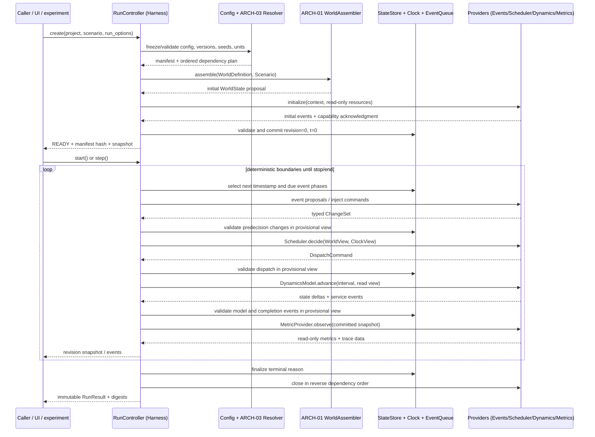

# ARCH-02 · Runtime Sequence and Architecture Walkthrough

> Normative target walkthrough; legacy differences are explicit.

## 1. Full sequence: project configuration to final result



The drawing describes logical responsibilities, **not** a claim that the existing Python code already has typed ChangeSets or commit barriers.

## 2. Boundary algorithm (pseudocode only)

```text
advance_boundary(handle):
  assert handle.state in READY|PAUSED|RUNNING
  fence := (generation, revision, clock, event_queue, component_state, rng_positions)
  target := clock_policy.next_boundary(clock, pending_events, horizon)
  if no target: finalize(COMPLETED, EMPTY_QUEUE)
  due := deterministic_sort(pop_due(target))
  stage due PRE_INPUT and PRE_DECISION proposals
  validate + stage predecision changes in provisional view
  view := immutable_state_snapshot()
  dispatch := scheduler.decide(view, read_only_context)
  validate + stage dispatch changes in provisional view
  physics := dynamics.advance(view_after_dispatch, clock, target)
  validate + stage model changes and service events in provisional view
  dispatch due postmodel events in canonical phase order
  validate + stage postmodel changes; atomically commit entire boundary including clock/queue/RNG
  publish read-only metrics and traces
  if termination_predicate(view) or horizon_reached: finalize(COMPLETED)
  otherwise return latest coherent snapshot
on precommit fatal error:
  discard entire uncommitted boundary and restore queue/RNG positions
  emit diagnostic; finalize(FAILED)
```

**Normative decision:** one atomic externally visible boundary commit, with ordered internal provisional views for subsequent phases. All staged phase state/clock/queue/RNG edits are discarded on precommit failure. There is no published intermediate phase revision and metrics run after the boundary commit. ARCH-01 must confirm that copy-on-write or equivalent provisional-view semantics can enforce this; LEGACY_OPAQUE_STEP is explicitly excluded.

## 3. Exact old chain (for compatibility baseline)

- console/server.py:69-76 creates one global SimSession and resets default greedy; :291-308 invokes session.step once per lock acquisition.
- console/sim_session.py:145-165 resets scheduler and Environment; :167-200 reads pre-step task/assignment/drone data, calls greedy policy or scheduler.step(obs, env.current_time), then env.step(action), records transitions/history, exposes snapshot.
- frontend/environment.py:1033-1134 mutates assignments from actions; :1136-1144 advances time by STEP_SECONDS and generates tasks; :1146-1250 updates drones, consumes service waypoint pops, records completions and berth allocation; :1252-1286 tests horizon/exhaustion, produces next obs/reward/done/info.
- frontend/evaluate_metrics.py:116-139 runs the same scheduler/env loop headlessly.
- console/sim_session.py:212-259 manual event injection updates env and refreshes _obs without a clock tick; :643-657 rebuild reloads modules; :441-547 checkpoints dynamic object tree and global RNG.

These calls do not grant future Harness ownership of city maps, drone energy models, algorithm choices, UI or research metrics.

## 4. Interface dependency table for cross-team review

| Interface | Producer/owner | Required by ARCH-02 | Open verification |
|---|---|---|---|
| WorldDefinition, Scenario, WorldState, WorldStatePatch | ARCH-01 | Initialize, snapshot, validate transaction | Stable IDs, units, schema versions, reference invariants |
| WorldClockContract / time-varying scenario events | ARCH-01 | Event injection and temporal validity | Absolute time origin, inclusivity, coordinate/temporal scope |
| ProviderManifest, capabilities/dependencies | ARCH-03 | Resolve deterministic assembly and call ordering | Explicit side effects, optional providers, semantic versions |
| Scheduler.decide & DynamicsModel.advance | ARCH-03 | Typed commands and state proposals | Read-only view versions, event API and deterministic data ordering |
| MetricProvider.observe | ARCH-03 | Observe postcommit state without writes | Incremental metric state checkpointing |
| LegacyEnvironmentAdapter and LegacySchedulerAdapter | ARCH-04 | Compatibility mode for unchanged main loop | Transaction limitations and observation mappings |
| PR #41 legacy lifecycle changes | Separate Draft PR against ci-validation | Re-audit compatibility before migration | Not part of master baseline |

## 5. Walkthrough tests expected of design reviewers

1. Switch from Shanghai/Yangpu map to a different city: new ARCH-01 WorldDefinition + SpatialProvider; Harness unchanged.
2. Replace energy model: swap manifest-compatible DynamicsModel; clock/transaction coordinator unchanged.
3. Add a new scheduler: register Scheduler capability; no changes in Harness decision sequence.
4. Inject wind and station failure mid-flight: ordered EventProvider proposals at declared time; domain state changes before a new scheduler observation; no hidden env mutation.
5. Use CSV missing height/units: reject at assembly or explicit versioned fill policy from provider; never silently assume a coordinate system.
6. Replay an old dataset and seed: freeze hashes and legacy mode, compare state/event trace with historical baseline; disclose expected non-equivalence between modes.
7. Pause at same-time event cascade: finish bounded phase and publish one coherent boundary; stop behavior reproducible.

## 6. Review gates and handoff

G0 / design review: six Markdown files present, only docs paths modified, immutable state writer and component rights explicit, clock and event tie-breakers stable, operational failure contract complete, ARCH-01/03 dependencies tracked. G1 / implementation phase only after ARCH-01/03 agree on time, state schema, transaction visibility and provider API, ARCH-04 maps legacy differences, and an independent reviewer examines fault and determinism scenarios.

**Not implemented here:** no changes to SimSession, Environment, UI, adapters, providers, tests, or Python run loop.
