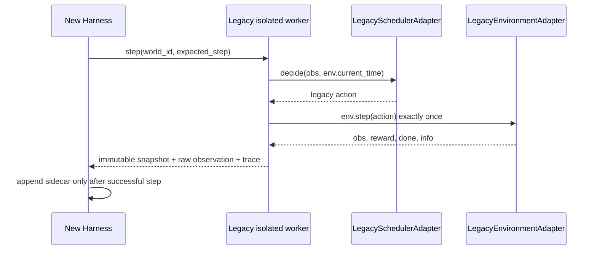

# ARCH-04 / Legacy Adapter 边界与草案契约

> **设计契约提案，非已经存在的类**。需要与 ARCH-01（World/Entity/Scenario）、ARCH-02（Harness 时钟/事务）、ARCH-03（组件能力/Manifest）对齐冻结后才编写代码。

## 1. 原则：包装，不“修正”

- Legacy Adapter **只能转译控制面与观察面**，不得重算飞行、能耗、任务服务、GA/PSO/贪心决策，也不得重新实现现有统计。
- LegacyEnvironmentAdapter 必须复用 `Environment.reset(seed)`、`Environment.step(action)`；LegacySchedulerAdapter 必须保留 `Greedy` 的 **函数决策路径**（`greedy_action_from_observation(obs)`）和 GA/PSO/OR-Tools 的 `scheduler.step(obs,current_time=env.current_time)`。
- 旧路径以进程为配置隔离边界；不要为了兼容多 World 而对 `SWARM_BALANCE_SIM_CONFIG`、Python/NumPy RNG、`importlib.reload` 施加进程内并发写入。
- Harness 不可反向改写 `Environment.__dict__`、`Task.status`、`Drone.is_free` 等计算源；只读视图须基于一次完成的 legacy step。
- 核心指标取 legacy `env.get_stats()`/`frontend.metrics_schema.to_output_metrics` 的既有语义（由实际实现核对后接线），不得在 adapter 中“猜”统计口径。
- 错误应有结构化类型（`invalid_config`、`component_mismatch`、`legacy_reload_failed`、`invalid_transition`、`snapshot_incompatible`、`runner_failed`），默认拒绝而不是吞掉。

## 2. 候选适配器 / 责任表

| 候选组件（建议模块） | 输入 / 输出 | 可写边界 | 明确禁止 |
| --- | --- | --- | --- |
| `LegacyConfigResolver`（`platform/adapters/legacy_config.py`） | 原始 config + base root → resolved paths、hash、legacy path policy | 只写运行专属临时目录 | 修改 `config/simulation.json`，猜测默认值或偷偷改字段 |
| `LegacyEnvironmentAdapter`（`platform/adapters/legacy_environment.py`） | map path、episode steps、data source、seed → environment handle；`step(action)` → 原始 `obs,reward,done,info` 和只读摘要 | 持有一个 worker 的 Environment 引用 | 重新执行物理模型；提前生成任务；对外可变引用 |
| `LegacySchedulerAdapter`（`platform/adapters/legacy_scheduler.py`） | algorithm key、seed、旧 obs/time → 原始 action | 持有同一 worker 的调度器对象 | 使用统一策略替代 Greedy；私改 config；隐藏可选依赖失败 |
| `LegacySessionAdapter`（`platform/adapters/legacy_session.py`） | `reset/step/snapshot/inject` 等 → legacy snapshot | 只由 Legacy Worker 单独调用 SimSession | 多线程同时操作；把 Web _session 伪装为多会话 |
| `LegacySceneImporter`（`platform/adapters/legacy_scene.py`） | 旧 schema 场景库 JSON → 验证后的只读 Scenario 草图 | 无 legacy 主配置写权限 | 把运行 checkpoint 当场景；丢掉算法/Seed/source |
| `LegacyMetricAdapter`（`platform/adapters/legacy_metric.py`） | 原始统计与 CSV → 原样读数 + provenance | 只写新路径附加 sidecar | 修改历史 CSV 表头/聚合/比较可比性 |
| `LegacyWorkerBridge`（`platform/adapters/legacy_worker.py`） | 隔离 worker 启动请求 → 逐步状态、输出路径、退出状态 | 管理新 worker 子进程及运行目录 | 共享全局 RNG/重载状态；吞失败；写旧 `one_click_latest.csv` |

文件名均为**候选**，最终以 ARCH-01/02/03 冻结契约为准；不要求全部同时实现。

## 3. 最小形态与能力声明（伪代码；不得视为可运行实现）

```python
@dataclass(frozen=True)
class LegacyRunSpec:
    world_id: str
    input_config_path: str        # resolved absolute path
    input_config_sha256: str
    osm_path: str
    osm_sha256: str
    algorithm_key: str            # greedy/ga/pso/ortools
    seed: int
    episode_steps: int
    engine_commit_sha: str
    parse_mode: str               # osmnx / fallback, known before run

class LegacyEnvironmentAdapter:
    def __init__(self, legacy_env):
        self._env = legacy_env
    def reset(self, seed):
        return self._env.reset(seed=seed)
    def step(self, action):
        return self._env.step(action)  # same order and same return tuple

class LegacySchedulerAdapter:
    def decide(self, obs, current_time):
        if self.algorithm_key == "greedy":
            return greedy_action_from_observation(obs)
        return self._scheduler.step(obs, current_time=current_time)
```

这段示意中 `world_id` 是平台侧运行身份，不能被传回 legacy 内核改变调度行为。真正 `LegacyRunSpec` 应包括单位、坐标系、库版本、cache/RNG 策略等；所有 SHA 在运行前计算并固定。

## 4. Harness 单步一致性（不可调整）



**不承诺替代 `SimSession` 所生成的完整 GUI snapshot**。S2 先验证 worker 单步语义；若需要 Web 兼容，在 S4 通过 `LegacySessionAdapter` **透传**原来的 snapshot（`algorithm,seed,step,time,done,num_drones,map,drones,nests,tasks,task_catalog,pending_count,controls,events,stats,history,health,demo,checkpoints` 等），不进行数据补算。

## 5. 生命周期、异常、资源与安全

- `create`：解析所有资源，记录 manifest，不触碰主 config；`initialize`：仅在隔离 worker 中加载 legacy 模块、设置 RNG/种子并 reset。
- `run/step`：验证 step 序号，只允许串行调用、单步一次；每次记录 raw action/事件摘要/核心指标以及单步序号，先提交内核后写 sidecar。
- `pause`：仅暂停下一步调度；不回滚已经执行的 legacy `env.step`；`stop`：有序停止、保留结果；`destroy`：只释放本 worker。
- `reset/rebuild`：重新建 worker 是最安全初始方案，严禁在多个 World 共享解释器里 `reload_sim_modules()`；legacy Web rebuild 继续保留原语义。
- 失败：worker 崩溃、OSM 模式不符、模型哈希失配、配置校验不通过、NaN 非法状态，停止该 run 并出诊断；不能默默换默认模型、seed 或解析器。
- **资源引用**：Scenario 指向只读 Dataset/ModelManifest（内容哈希）；地图/机队/时间单位在 assemble 时校验。资源只读，实例状态由 worker 独占。
- **可回滚**：运行选择器 `legacy_direct` / `legacy_harness`（新路径默认关闭），恢复时不改旧配置或旧结果。

## 6. 外部共同冻结条件

ARCH-01 明确 World/Scenario/WorldState 以及空间坐标和时间单位；ARCH-02 冻结一步提交/事件顺序/失败策略；ARCH-03 冻结 DataProvider/SpatialProvider/DynamicsModel/Scheduler/MetricProvider 的 capability/manifest 结构。任何一项未冻结，不启动适配器代码 PR。**禁止把“遗留内核运行成功”冒充“平台各组件已可插拔”。**
