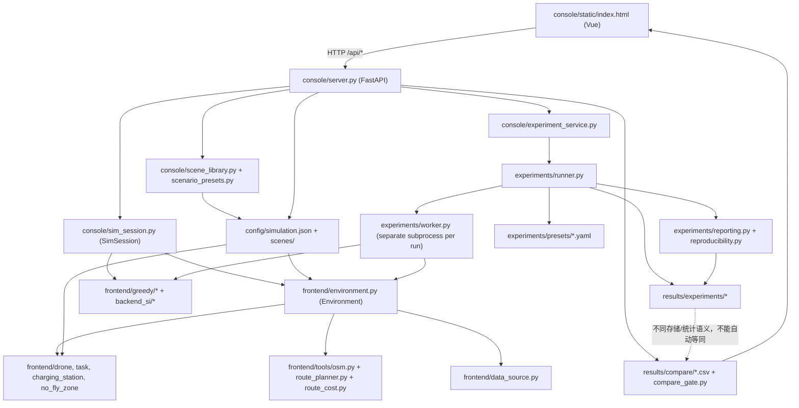

# ARCH-04 / 现有系统架构与依赖图

> **状态：设计审计（静态）**｜审计日期 2026-10-15｜基线 `master@2ab60c69a806a22d7ba20353dee0571752a0e8e5`。以下“已证实”仅指在此 SHA 的源码中可定位；**没有实际执行新 Harness、迁移对照或端到端运行验证**。不得把尚未合并的 PR #41–#45 当成 master 事实。

## 1. 重要术语与真实目录角色

- `frontend/` 是 **Python 仿真域核心**，并非 Web 前端；包含 `environment.py`、`drone.py`、`task.py`、`charging_station.py`、`no_fly_zone.py`、`route_planner.py`、`route_cost.py`、`tools/osm.py`、`data_source.py`、`metrics_schema.py`、`greedy/scheduler.py`。
- `console/static/index.html` 是 **Vue global build 单 HTML 控制台**，访问 FastAPI `console/server.py`；`console/sim_session.py` 包装内核并生成可视化快照。参见 PR #43 [UI-00](https://github.com/159357yangjun/SwarmBalance/pull/43)，该 PR 仍独立未合并。
- `config/` 提供 `simulation.json`、位置文件、导入数据和持久化场景库；`config/config_loder.py`（保持仓库现有拼写）提供共享配置读取与签名。
- `backend_si/` 提供 PSO、GA、OR-Tools 调度器以及 `config.yaml`；Greedy 实现在 `frontend/greedy/`。
- `experiments/` 提供预设、`runner.py` 批量计划/汇总、`worker.py` 单次独立运行、`reproducibility.py` 溯源记录、`reporting.py` 统计。
- `results/` 是历史/当前实验数据和可比性边界：`experiments/` 的逐 run、计划、汇总、清单；`compare/` 的既有比较 CSV 与 `compare_gate.py`，以及绘图消费者。

## 2. 模块依赖 / 数据流（现状，不是目标架构）

**解读**：控制台的交互式路径与批量实验路径共同引用仿真内核和算法，但不共享同一个 `SimSession`。批量实验 runner 为每个 run 生成 `_run_configs/run_NNNN.json`，然后以 `python -m experiments.worker` 子进程启动；worker 在导入内核前设置 `SWARM_BALANCE_SIM_CONFIG`。该进程隔离方式是现有的重要安全资产，不应被无条件替换为线程/进程内多会话。

## 3. 真实调用链

| 入口 | 关键调用顺序 | 外部可观察行为 |
| --- | --- | --- |
| Web 初始化 | `/api/snapshot` → `_get_session()` → `SimSession()` → `Environment(OSM)` → `reset(greedy,100)` | 服务启动时异步预热；未就绪的 snapshot 返回 202；全服务进程共享 `_session` |
| 单步 | `/api/step` → `SimSession.step` → Greedy `greedy_action_from_observation` / 其他 `scheduler.step(obs,current_time)` → `env.step(action)` | step 后采集轨迹、事件、历史统计并输出 snapshot；HTTP count 限制 1–50 |
| 配置重建 | Web 更新 JSON/YAML → `/api/rebuild` → `reload_sim_modules` → `Environment(...)` → `reset` | 重置动态运行态；旧 checkpoint 仍列出但结构代次不同时拒绝恢复 |
| 场景 | `scene_library.py` 磁盘 JSON / `scenario_presets.py` 可逆 patch | 场景＝初始配置，不等同运行态 checkpoint |
| 批量实验 | `experiment_service.start` → `run_conclusion.py` → `experiments.runner` → 每 run `experiments.worker` | 不占用交互 `SimSession`；产出 `raw_runs.csv`、`plan.csv`、`reproducibility.json` 等 |
| 比较图 | `/api/compare` → 选取 CSV → `results/compare_gate.py` 的口径校验 → Vue 图表 | 不可比时不得给算法“胜者”结论 |

## 4. 源码证据（固定 SHA）

- [`console/server.py:25-75`](https://github.com/159357yangjun/SwarmBalance/blob/2ab60c69a806a22d7ba20353dee0571752a0e8e5/console/server.py#L25-L75)：模块连线、单会话、锁；[`:263-308`](https://github.com/159357yangjun/SwarmBalance/blob/2ab60c69a806a22d7ba20353dee0571752a0e8e5/console/server.py#L263-L308)：reset、step 的锁及执行语义。
- [`console/sim_session.py:32-70`](https://github.com/159357yangjun/SwarmBalance/blob/2ab60c69a806a22d7ba20353dee0571752a0e8e5/console/sim_session.py#L32-L70)：sys.path 和热重载；[`:103-200`](https://github.com/159357yangjun/SwarmBalance/blob/2ab60c69a806a22d7ba20353dee0571752a0e8e5/console/sim_session.py#L103-L200)：会话建构与调度循环；[`:441-550`](https://github.com/159357yangjun/SwarmBalance/blob/2ab60c69a806a22d7ba20353dee0571752a0e8e5/console/sim_session.py#L441-L550)：checkpoint/RNG。
- [`frontend/environment.py:87-171`](https://github.com/159357yangjun/SwarmBalance/blob/2ab60c69a806a22d7ba20353dee0571752a0e8e5/frontend/environment.py#L87-L171)：模块级模型配置与 OSM 构造；[`:1136-1170`](https://github.com/159357yangjun/SwarmBalance/blob/2ab60c69a806a22d7ba20353dee0571752a0e8e5/frontend/environment.py#L1136-L1170)：时钟、生成、运动/能耗。
- [`experiments/runner.py:520-529`](https://github.com/159357yangjun/SwarmBalance/blob/2ab60c69a806a22d7ba20353dee0571752a0e8e5/experiments/runner.py#L520-L529)、[`:569-620`](https://github.com/159357yangjun/SwarmBalance/blob/2ab60c69a806a22d7ba20353dee0571752a0e8e5/experiments/runner.py#L569-L620)；[`experiments/worker.py:37-76`](https://github.com/159357yangjun/SwarmBalance/blob/2ab60c69a806a22d7ba20353dee0571752a0e8e5/experiments/worker.py#L37-L76)。
- [`frontend/metrics_schema.py:51-87`](https://github.com/159357yangjun/SwarmBalance/blob/2ab60c69a806a22d7ba20353dee0571752a0e8e5/frontend/metrics_schema.py#L51-L87)、[`results/compare_gate.py`](https://github.com/159357yangjun/SwarmBalance/blob/2ab60c69a806a22d7ba20353dee0571752a0e8e5/results/compare_gate.py)、[`console/server.py:894-952`](https://github.com/159357yangjun/SwarmBalance/blob/2ab60c69a806a22d7ba20353dee0571752a0e8e5/console/server.py#L894-L952)。

## 5. 当前边界与尚待动态验证

当前 `master` 的 Web 属于单会话架构，数据和内核依赖是**调用级发现**而不是已执行的依赖自动检测结果。尚未验证线程安全、平台跨进程表现、地图缓存损坏恢复、所有算法在新 Harness 下的行为对照。不能把此文中的建议边界误标为已实现功能。详见 `COUPLING_ANALYSIS.md` 与 `MIGRATION_SLICES.md`。
