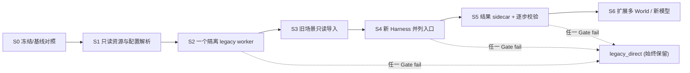

# ARCH-04 / 渐进迁移纵切计划与阶段验收

> **计划而非执行报告。** ARCH-04 本次仅交付设计文档；任何代码实施均要另开 PR，首先进入 G-M0 冻结和 RED 证据，再做最小实现、对照和审查。新旧双路径的默认是 `legacy_direct`；永不以“先整体重构，再补测试”换取速度。

## 总体路线

## 文件边界、门禁、回退（每阶段独立 PR）

| 纵切 | 允许的**新增/极少量触及**文件（提议） | 先行测试/兼容条件 | 实现后验收 | 回退 |
| --- | --- | --- | --- | --- |
| **S0 研究基线冻结** | `docs/platform/evidence/*`、`tests/platform/test_legacy_baseline.py`（新增） | 原样采集旧 Web/worker 核心输出 golden；固定 master SHA + 依赖/地图/原始参数 + compare CSV 哈希；确认 #41 是否仍未合并 | G-M0，记录 K0 与静风 E0/E1 门；必须先有真实运行证据 | 无运行改动，撤销本 PR |
| **S1 配置与资源只读装配** | `platform/adapters/legacy_config.py`、`platform/manifests/*`、`tests/platform/test_config_resolver.py`（均新增） | 先写旧路径、环境覆写、OSM/CSV、未知 schema 的 RED/negative tests | G-M1：得到与旧解析一致的绝对路径、SHA；**不得写回** `config/*` | 关闭新解析路径，使用旧 `get_shared_config` |
| **S2 单 worker 最小纵切** | `platform/adapters/{legacy_environment,legacy_scheduler,legacy_worker}.py`、`tests/platform/test_legacy_step_parity.py`（新增） | 先冻结动作/观测/状态/指标逐步 golden；worker 必须进程隔离；Greedy 函数分支保留 | G-M2/G-M4：同地图/同模型/同输入/同 seed 每步对照，静风先行，逐算法增加；首次分叉即拒绝 | 不启动 Harness worker；旧 console/experiments 原样可用 |
| **S3 历史场景只读兼容** | `platform/adapters/legacy_scene.py`、`tests/platform/test_legacy_scene.py`（新增） | 测场景 schema_version、算法/Seed、默认地图；明确禁止 import checkpoint 并写回 | G-M1/G-M5：旧场景读入新 Scenario schema 草图不丢语义，错误可解释 | 停止新导入器，旧 `console/scene_library.py` 留存 |
| **S4 双运行路径接入** | `platform/runtime/mode_selector.py`、`platform/runtime/harness_bridge.py`、`tests/platform/test_dual_path.py`（新增）；若必须改 `console/server.py` 只能加 **opt-in 新路由**，不可改旧 `/api/*` 返回 | 先以 contract tests 守护 `snapshot/reset/step` 和锁语义；需 ARCH-01/02/03 三方冻结 | G-M2/G-M7：默认旧路径、失败可手动切回、旧 UI 操作和 compare gate 保持可用 | flag 设 `legacy_direct`，新路由不再服务；不得回写旧 JSON |
| **S5 结果与科研证据并行** | `platform/reporting/{manifest,parity}.py`、`results/platform_runs/` 新 run 子目录、`tests/platform/test_results_compat.py`（新增） | 先冻结 `METRIC_COLUMNS`、`compare_gate` 正负案例及旧输出哈希；不得改 `results/compare/*` | G-M3/G-M6：包含 R01–R12 明确状态、样本 ID、差异归因；E0/静风 E1 同配置门继续有效 | 关新 reporter，保留 sidecar 取证；历史结果零改动 |
| **S6 多 World / 新模型（非 ARCH-04 首个交付）** | ARCH-01/02/03 指定的独立组件包 + 新测试，不直接触碰 legacy core | 多实例 RNG/模块常量/解析器已无交叉污染证据；独立认证新物理模型 | K4：不同模型各自 provenance 与差异解释；**不追求不同模型输出相同** | 禁用新组件/退回 S4，legacy engine 仍可用 |

文件示例是**建议白名单**，以实际独立 PR 的文件清单、ARCH-01/02/03 冻结接口审查通过为准。任何阶段跨范围编辑仿真物理/算法/指标，即停止该 PR 并单独研究审查。

## 最小纵切“定义完成”——不等于平台重构完成

单个 Project、单个 Scenario（默认 OSM + Greedy）、一个独立进程的 Legacy Environment、一个调度器、一条 `reset → step → snapshot → stop`，输出一个新的 provenance sidecar。与原 `experiments.worker` 使用相同 Engine/Seed/配置，验证在可重复条件下动作和状态迁移不分叉。通过后再加入 GA/PSO/OR-Tools，再接旧场景与控制台。

### 从 RED 到 GREEN 的推荐 PR 节奏

1. **测试 PR**：只加基线 fixture + 不变式 + 负例，先证明旧行为可复现、对照脚手架真的能抓到故意改变一步顺序或缺失指标。
2. **adapter PR**：仅新增 `platform/adapters` 最小代理，不动 `frontend/*` 内核；逐步证明 K1。
3. **integration PR**：接入新 Harness；开启 opt-in 新路由前要求 G-M0～G-M5 全绿。
4. **reporter PR**：并行写 sidecar、数据对照、故障/回滚证明，要求 G-M6～G-M7。

## 横向治理与实施阻断

| 关联对象 | 前置要求 | 无法满足时 |
| --- | --- | --- |
| ARCH-01 | WorldState/Scenario/实体引用、坐标系、单位、时间明确 | 停 S3/S4，不臆造字段 |
| ARCH-02 | 引擎时钟所有权、一步提交、异常事务性、生命周期明确 | 停 S2/S4，不自创事件先后 |
| ARCH-03 | Scheduler/SpatialProvider/DynamicsModel 等最低能力和 manifest 定义 | 停 S2/S6，不承诺插件互换 |
| PR #41 | 若评测采用其 L1 变更，独立 pin `f1bf21cc...` 等 HEAD、与 master 分桶；不得悄然共用“同模型”键 | HOLD K1，继续 master 基线 |
| PR #42–#45 / TaskUI G0 | 当前 G0 HOLD；迁移方案不能批准 UI 改版；新控制台界面需按 TaskUI G0/G1 单独审 | 保留旧 UI，不将 G0 HOLD 解释为解除 |
| 历史结果 | 旧 results/compare 和 experiments 文件写前/写后 SHA 完全不变；compare gate 拒绝试验成功 | 不允许发布“可比较的科研结论” |
| 回退 | 每个阶段可在当前旧入口演示 reset、step、实验 worker、compare 只读成功 | 该阶段不能合并、不能进下一阶段 |

## 交付与验收记录模板

每阶段 PR 必含：`base_sha/head_sha`、变更白名单、模型/数据/代码哈希、RED 失败与 GREEN 真实命令/日志、逐步首次分叉报告、所有 K/G 门状态、风险 R01–R12、回退操作与演练证据、尚存阻断项。不得用“预计通过”、“理论相同”冒充实测通过。

**ARCH-04 设计审查提议：文档可进入讨论，不代表实现 G-M0～G-M7 PASS，也不代表 G0/G1 已通过。**
